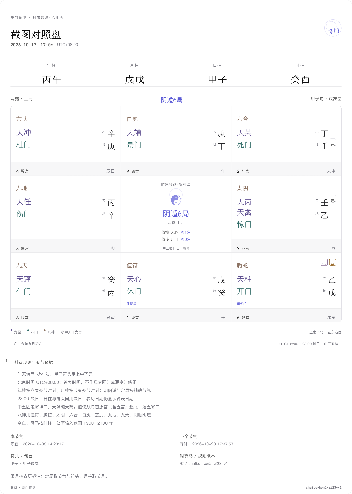

# 奇门排盘与导出验收

验收日期：2026-10-24。规则版本：`chaibu-kun2-zi23-v1`。

## 已执行

- `npm run typecheck`：通过。
- `npm test`：原有紫微、运限、历法、AI 模拟接口、K 线等回归通过；本次未更改紫微计算代码。
- `npm run test:qimen`：通过。三个截图转录例、立春/夏冬至交节、23 点换日换元、甲时隐甲、中五原宫计时、闰月/闰日及输入校验；437 盘不变量覆盖十八局，上海/UTC/纽约三个独立进程结果一致。
- `npm run build`：通过，含 `/qimen` 的生产页面生成。
- 额外独立执行 `qimen-rs 0.2.1` 对照 1,152 盘：1900、2000、2026、2100 年，每月 1 日和 16 日、12 时辰；四柱、节气、遁局、符使及全九宫星门神、天地寄干、时空与时马一致。该工具只用于临时核对，未加入应用依赖。双方历法有共同 sxwnl 谱系，不能称为独立天文精度认证。

## 浏览器实测

在本地 `/qimen` 执行：

- 自动按当前北京时间起盘、载入截图样例、前后时辰、宫位选择。
- 表单尚未提交时保留当前盘，并明确提示当前导出对应的时间。
- 存档、打开存档；完整快照和规则版本保留。
- 复制成功；实际剪贴板与下载 MD 在归一化 Windows 换行后完全一致。
- 实际下载 PNG，打开图片确认九宫、寄干、标记、完整规则和交节时间；修复 html2canvas 对选中宫位内阴影的异常渲染，导出不包含 UI 焦点高亮。
- 390px 手机视口下，页面及八个宫位均无水平溢出；九星字号 17px。手机完整长截图工具未成功，因此不宣称做过手机全页面像素复核。
- 最终页面控制台未记录错误。

## 维护边界

页面、复制和导出是同一确定性盘；未接入奇门 AI 断语，未复制复杂旺衰/吉凶格局。旧规则存档使用自身时区、方法及规则说明，不套用当前口径。损坏盘库、存储配额和剪贴板不可用均有反馈；损坏数据不会被写入覆盖。

GitHub CI 结果以对应 PR 最终提交的检查页为准，本记录不预先宣称远端成功。独立工作区基于最新 dev，并合入已发布但未合并的白紫风格 / K 线分支作为界面依赖；原工作区尚未提交的其他紫微变更未纳入本次发布。
